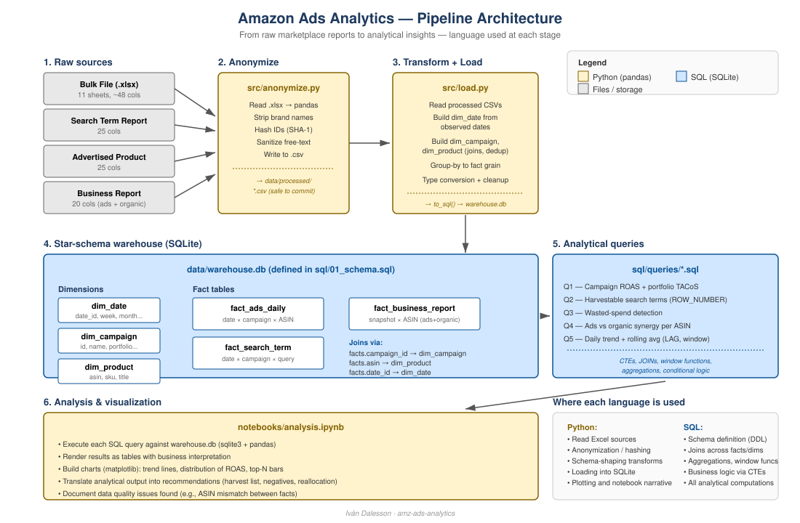
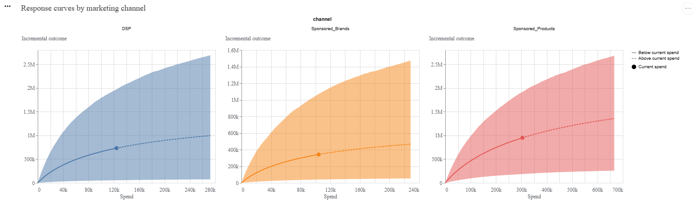
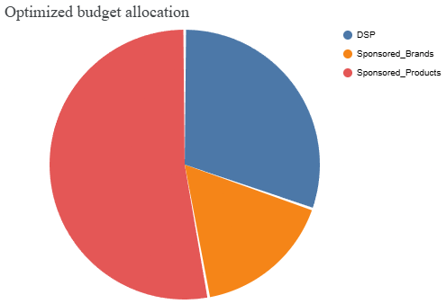
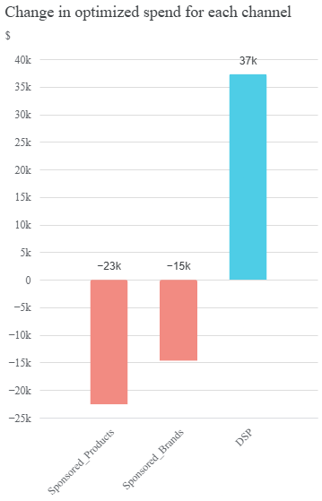

# Amazon Ads Analytics — dbt/BigQuery Warehouse + Marketing Mix Model

A data engineering and analytics project that takes raw Amazon Advertising reports
(in Excel), anonymizes them, and models them into a star-schema warehouse in two
parallel implementations: a **dbt + BigQuery Analytics Engineering layer**
(staging → marts, tested and documented — see [`amazon_ads_dbt/`](amazon_ads_dbt/))
and the original **SQLite prototype** below, which also feeds a
**Marketing Mix Model** to decompose sales attribution and optimize budget
allocation across channels.

## Analytics Engineering layer — dbt + BigQuery

The production-shaped version of this warehouse lives in
[`amazon_ads_dbt/`](amazon_ads_dbt/): the same four Amazon report sources,
modeled as dbt staging → marts layers running against BigQuery, with data
tests on every model (`unique`, `not_null`, `relationships`, and a
`dbt_utils.unique_combination_of_columns` grain test), a
`fact_weekly_channel_performance` mart by ad product (SP/SB/SD) - period
totals on this sample, since the reports are monthly summaries - and an
`mmm/` folder of synthetic weekly marts that feed the dashboard below. See that folder's own README for the model list, lineage, and
how to run it — that's the piece most relevant if you're evaluating this repo
for an **Analytics Engineer** role specifically.

## Dashboard — Data Studio

[**Amazon Ads — Simulated Performance Dashboard**](https://datastudio.google.com/reporting/6c8e6915-9916-4f4a-937c-871c8abd31d9)

Built in Data Studio (formerly Looker Studio) on top of the dbt marts in
`amazon_ads_dbt/models/mmm/`: scorecards with year-over-year comparison
(ad spend, total sales, ROAS, TACoS), weekly sales vs spend, spend by
channel (SP / SB / DSP), ads vs organic sales, and channel mix. Ratios are
calculated fields built as ratios of sums, so they stay correct at any
aggregation level.

**The dashboard runs on the 2-year synthetic dataset, not client data**
(see "Note on data" below) - it says so on the page.

## Architecture (SQLite prototype + MMM)



| Stage | Language | Module |
|---|---|---|
| 1. Read raw .xlsx reports | Python (pandas) | `src/anonymize.py` |
| 2. Strip brand names, hash IDs, write CSV | Python | `src/anonymize.py` |
| 3. Transform to schema-shaped tables | Python | `src/load.py` |
| 4. Define warehouse schema | SQL (DDL) | `sql/01_schema.sql` |
| 5. Load tables into SQLite | Python + SQL | `src/load.py` |
| 6. Analytical queries | SQL | `sql/queries/*.sql` |
| 7. Notebook narrative & charts | Python (pandas, matplotlib) | `notebooks/analysis.ipynb` |
| 8. MMM data preparation | Python | `src/mmm_prep.py` |
| 9. MMM model + budget optimizer | Python (scikit-learn, scipy) | `notebooks/mmm_model.ipynb` |
| 10. Bayesian MMM (Google Meridian) | Python (Meridian, TFP) | `notebooks/meridian_mmm_amazon_ads.ipynb` |

---

## Data sources

Four Amazon report types feed the warehouse:

- **Bulk file** — the master campaign structure (Portfolios, Campaigns, Ad Groups, Keywords, Product Ads). Multi-sheet Excel.
- **Search Term Report** — every customer search query that triggered an ad, with performance.
- **Advertised Product Report** — per-ASIN ad performance.
- **Business Report** — total sales (ads + organic) at the ASIN level. The piece that lets us compute TACoS.

**Reporting window and grain:** the sample covers February 2025 and the
Advertised Product and Search Term reports were exported as **monthly
summaries**, not daily rows: each row is the period total for a
campaign/ASIN (or search term), and `Start Date`/`End Date` mark its first
and last active day. The warehouse therefore supports period totals and
cross-sectional analysis (campaigns, ASINs, search terms, ad products), but
not daily or weekly trends - which is why the MMM below runs on synthetic
data.

Neither the raw files nor the anonymized CSVs in `data/processed/` are
committed (raw files contain identifiable brand data; see `.gitignore`), so
the warehouse can't be rebuilt from this repo alone - the code, schema,
models and tests are what's shared.

---

## Schema

A star schema with three fact tables (different grains) and three shared dimensions:

- `dim_date`, `dim_campaign`, `dim_product`
- `fact_ads_daily` — report row × campaign × ASIN, keyed on first active date (daily grain once reports are pulled with a daily time unit)
- `fact_search_term` — report row × campaign × search query, same caveat
- `fact_business_report` — snapshot × ASIN grain (ads + organic sales)

Schema is defined in `sql/01_schema.sql` and is dialect-agnostic
(developed on SQLite, will run on PostgreSQL or any analytical engine).

---

## Analytical queries

Each query in `sql/queries/` answers a concrete business question. They
demonstrate JOINs across facts and dimensions, CTEs for staged logic,
window functions (`ROW_NUMBER`, `LAG`, rolling averages), and conditional
aggregation.

| File | Question | Techniques |
|---|---|---|
| `01_campaign_roas_tacos.sql` | Which campaigns are most efficient on their own ROAS — and how do they look against total business sales (TACoS)? | CTEs, cross-join, aggregation |
| `02_harvestable_search_terms.sql` | Which broad/auto search terms have converted profitably and should be promoted to exact-match campaigns? | `ROW_NUMBER`, partitioned ranking |
| `03_wasted_spend.sql` | Which search terms are burning budget without converting? Candidates for negative keywords. | Conditional logic, filtering on aggregates |
| `04_ads_vs_organic_synergy.sql` | For each product: what share of sales is from ads vs organic? Where is ad dependency too high? | Multi-fact join, label classification |
| `05_daily_trend_anomalies.sql` | Daily spend and ROAS trend with rolling 7-day average and anomaly flags. Monitoring pattern for daily-grain data - on this monthly-summary sample the series is by start date, so the flags aren't meaningful (noted in the file). | `LAG`, window functions, rolling ratio-of-sums |

---

## Marketing Mix Model

`src/mmm_prep.py` + `notebooks/mmm_model.ipynb`

The MMM layer sits on top of the warehouse and answers the question that
no last-click attribution model can: **what actually caused the sales?**

### What it does

1. **Data prep** (`src/mmm_prep.py`) — pulls weekly aggregated spend and
   sales from the warehouse, applies adstock and Hill saturation transforms,
   and generates a synthetic 2-year dataset (see note below).

2. **Model** (`notebooks/mmm_model.ipynb`) — fits an OLS regression with
   transformed channel spend as features, decomposes total sales into
   baseline organic + channel contributions + seasonality, and runs a
   budget optimizer via `scipy.optimize`.

3. **Outputs** — five charts, rendered in the notebook and written to `data/mmm/` when you run it:

| Chart | What it shows |
|---|---|
| `01_eda_overview.png` | Weekly spend by channel, total vs organic sales, TACoS trend, spend/sales scatter |
| `02_sales_decomposition.png` | Stacked area of sales by source + attribution pie chart |
| `03_response_curves.png` | Diminishing returns curve per channel with marginal return at current spend |
| `04_budget_optimizer.png` | Current vs recommended budget allocation (same total spend) |
| `05_actual_vs_predicted.png` | Model fit — actual vs predicted with R² and MAPE |

### Key results vs ground truth (synthetic dataset)

Because the data is synthetic, every estimate can be checked against the
parameters that generated it (`data/mmm/true_parameters.csv`):

| Source | Sales attribution — model | Attribution — true | Response coefficient — model | Coefficient — true |
|---|---|---|---|---|
| Baseline organic | 47.4% | 46.2% | $8,217 / week | $8,000 / week |
| Sponsored Products | 41.7% | 40.4% | 3.62 | 3.5 (+3%) |
| Sponsored Brands | 7.8% | 8.6% | 1.81 | 2.0 (−9%) |
| DSP | 3.0% | 4.9% | 0.74 | 1.2 (**−38%**) |

Model fit: R² = 0.995 · MAPE = 2.3%. **Read this with care:** the adstock
decays and Hill half-saturation points are fixed at the same values used to
generate the data, so the model is handed the true functional form. The fit
validates the estimation and decomposition code; it is not evidence of
forecasting accuracy. Even so, DSP - the channel with the most carryover -
is underestimated by 38%.

**Budget optimizer:** at the same total weekly budget, it moves 100% of
spend into Sponsored Products and cuts SB and DSP to $0. That corner
solution comes from the data generator, not from the optimizer: the
synthetic channel response is `beta × spend × hill(adstock(spend))`, which
never saturates - marginal ROI converges to `beta` instead of falling
toward zero (SP still returns ~$3.5 per $1 at 10× its average spend) - so
the highest-beta channel always wins. Fix planned for v2 (below).

### Note on data

> The real sample is a single one-month summary export - no time series at
> all, so nothing to fit an MMM on (≥52 weeks of weekly data is the usual
> minimum). `src/mmm_prep.py` generates a 2-year weekly synthetic dataset
> with known ground-truth parameters (committed in `data/mmm/`), which is
> what makes the validation above possible. The code is written to run on
> real weekly data; the limitations listed here are documented so they
> aren't mistaken for results.

### MMM transforms

- **Adstock (geometric decay)** — models the carry-over effect of advertising.
  SP decay=0.5, SB decay=0.3, DSP decay=0.7 (DSP has highest brand awareness persistence).
- **Hill transform** — meant to model diminishing returns as spend increases.
  Half-saturation points: SP=$3000, SB=$1500, DSP=$1000. As wired into the
  generator (multiplied by spend) it does not produce diminishing returns -
  see the optimizer note above.

### Planned v2
- Saturating channel response in the generator (`beta_max × hill(adstock(spend))`)
- Estimate adstock and saturation parameters (grid search / Bayesian)
  instead of fixing them at the true values
- Per-channel min/max spend bounds in the budget optimizer
- Re-run Meridian on the same dataset as the OLS model, so both can be
  validated against the same ground truth

### Production improvements (not in scope here)
- External regressors: price index, competitor activity, macro indicators
- Minimum spend constraints in budget optimizer per channel
- Orchestration via Airflow DAG

---

## Bayesian Marketing Mix Model — Google Meridian

[](https://colab.research.google.com/github/ivandalss/amazon-ads-data-pipeline/blob/main/notebooks/meridian_mmm_amazon_ads.ipynb)

`notebooks/meridian_mmm_amazon_ads.ipynb`

An extension of the OLS MMM layer using **Google Meridian** — the industry-standard
open-source Bayesian MMM framework. While the OLS model gives point estimates,
Meridian uses **MCMC (No-U-Turn Sampler)** to produce full posterior distributions,
quantifying uncertainty for every estimate.

### Why Bayesian over OLS

| | OLS MMM | Bayesian MMM (Meridian) |
|---|---|---|
| ROI output | Single point estimate | Full posterior distribution |
| Uncertainty | None | 90% credible intervals |
| Prior knowledge | Not possible | Inject via priors |
| Short data histories | Unstable | Stabilized by priors |
| Industry standard | Legacy | Current standard (Meridian, Robyn, PyMC) |

### What the notebook does

1. **Data prep** — builds its own 104-week synthetic dataset inline (seed 42) for the warehouse channels (SP, SB, DSP): `sales = 50,000 × seasonality + 3.5·SP + 2.0·SB + 1.2·DSP + noise`. Linear, with no adstock or saturation - and **not the same dataset as the OLS model above** (v2 unifies them)
2. **InputData** — formats data into Meridian's `xr.DataArray` format with correct dimension names
3. **Model config** — sets a weakly informative `LogNormal(0.2, 0.9)` ROI prior (median ≈ 1.2)
4. **Prior sampling** — verifies prior behavior before fitting
5. **Posterior sampling** — runs MCMC (4 chains, 500 adapt + 500 burnin + 1000 kept samples) on GPU
6. **Response curves** — visualizes diminishing returns per channel with credible intervals
7. **Budget optimizer** — recommends optimal budget reallocation at same total spend

### Key results vs ground truth

| Channel | Median ROI | 90% Credible Interval | True ROI | Contribution — model | Contribution — true |
|---|---|---|---|---|---|
| Sponsored Products | $2.93 / $1 | $0.61 — $6.30 | $3.50 | 13.4% | 16.0% |
| Sponsored Brands | $2.11 / $1 | $0.38 — $10.26 | $2.00 | 3.3% | 3.1% |
| DSP | $4.08 / $1 | $0.44 — $15.87 | **$1.20** | 7.6% | 2.2% |

SP and SB land close to their true values. **DSP is overestimated 3.4×**
(median 4.08 vs a true 1.2), although the true value does sit inside the
90% interval. Likely contributors, not yet isolated: Meridian's default
adstock + Hill structure fitted to data generated with neither; a single
national series of 104 weeks; a wide ROI prior; and DSP's right-skewed
spend, where a handful of large weeks carry the estimate.

### Response curves by channel



*Shaded area = 90% credible interval. Dot = current spend level. Curve flattening = saturation.*

### Optimized budget allocation



### Recommended spend change vs current



*The optimizer recommends shifting ~$37k from SP/SB toward DSP. Against the ground truth that is the wrong call - DSP has the lowest true ROI. That is exactly why the models here are validated on data with known parameters before any optimizer output is trusted.*

### How to run

The notebook requires a GPU for MCMC sampling (~10-15 min on T4). Open directly in Colab:

[](https://colab.research.google.com/github/ivandalss/amazon-ads-data-pipeline/blob/main/notebooks/meridian_mmm_amazon_ads.ipynb)

## How to run

Prerequisites: Python 3.11+, `pip install -r requirements.txt`.

```bash
# 1. Place raw .xlsx files in data/raw/
# 2. Anonymize:
python src/anonymize.py
# 3. Build warehouse:
python src/load.py
# 4. Ads analytics notebook:
#    Open notebooks/analysis.ipynb and run all cells.

# 5. MMM prep: writes data/mmm/weekly_synthetic.csv + true_parameters.csv
#    (both already committed) and, if data/warehouse.db exists, weekly_actuals.csv
python src/mmm_prep.py
# 6. MMM model + optimizer:
#    Open notebooks/mmm_model.ipynb and run all cells.
```

End-to-end runtime on the sample dataset: ~15 seconds.

---

## What this project demonstrates

- **ETL fundamentals:** multi-source ingestion, schema design, idempotent
  loads, separation of raw / processed / warehouse layers.
- **SQL fluency:** CTEs, window functions, multi-fact joins, conditional
  aggregations across a real star schema.
- **Data-quality awareness:** anonymization layer, deterministic ID
  hashing (joins still work), documented mismatches (e.g., Parent vs
  Child ASIN coverage between facts), and catching that the source
  reports are period summaries rather than daily rows.
- **Model validation against ground truth:** every MMM estimate is checked
  against the parameters that generated the data - including where the
  models get it wrong (DSP underestimated 38% by OLS, overestimated 3.4× by
  Meridian; a non-saturating response that drives the optimizer to a
  corner).
- **Marketing measurement thinking:** TACoS vs ACoS, keyword harvesting,
  negative keywords, ads-vs-organic synergy — real questions from agency life.
- **MMM methodology:** adstock transforms, Hill saturation, OLS decomposition,
  budget optimization via constrained numerical optimization.
- **Engineering trade-offs:** SQLite for portability in this MMM
  prototype (the warehouse migration to BigQuery is done, in
  `amazon_ads_dbt/` — not yet wired into the MMM notebooks), no
  orchestration for a 2-script pipeline (Airflow DAG in production),
  synthetic data with documented limitations.

---

## What's intentionally not in scope (and why)

These apply to the SQLite/MMM side of the repo described above. The
managed-warehouse gap is actually closed — see
[`amazon_ads_dbt/`](amazon_ads_dbt/) for the same warehouse running on
BigQuery with dbt, tests, docs, and CI; it just isn't what feeds the MMM
notebooks yet (see "Why this exists" in that folder's README).

- **No orchestration tool (Airflow/Prefect):** two scripts run in order is
  fine for a 4-source pipeline. In production, this would be a DAG.
- **No streaming:** marketplace reports are batch by nature.
- **No geo-level MMM:** national-level model used for simplicity. Meridian supports full geo-hierarchical modeling when geo-level data is available.

---

## File structure

```
.
├── README.md
├── requirements.txt
├── .github/
│   └── workflows/
│       └── dbt_ci.yml        # dbt build (run + test) on push, keyless GCP auth via WIF
├── amazon_ads_dbt/           # dbt + BigQuery Analytics Engineering layer — see its own README
│   ├── README.md
│   ├── models/
│   │   ├── staging/
│   │   ├── marts/
│   │   └── mmm/              # synthetic weekly marts feeding the dashboard
│   └── ...
├── docs/
│   └── architecture.svg
├── src/
│   ├── anonymize.py          # PII stripping + deterministic hashing
│   ├── load.py               # ETL → SQLite warehouse
│   └── mmm_prep.py           # Weekly aggregation + synthetic data generator
├── sql/
│   ├── 01_schema.sql
│   └── queries/
│       ├── 01_campaign_roas_tacos.sql
│       ├── 02_harvestable_search_terms.sql
│       ├── 03_wasted_spend.sql
│       ├── 04_ads_vs_organic_synergy.sql
│       └── 05_daily_trend_anomalies.sql
├── notebooks/
│   ├── analysis.ipynb        # SQL analytics narrative + charts
│   ├── mmm_model.ipynb       # OLS MMM model, decomposition, budget optimizer
│   └── meridian_mmm_amazon_ads.ipynb  # Bayesian MMM with Google Meridian (run in Colab)
└── data/
    ├── raw/                  # .gitignored — identifiable .xlsx files
    ├── processed/            # .gitignored — anonymized .csv, rebuild with python src/anonymize.py
    ├── mmm/                  # weekly_synthetic.csv + true_parameters.csv (committed); notebook charts land here
    └── warehouse.db          # .gitignored — rebuild with python src/load.py
```
